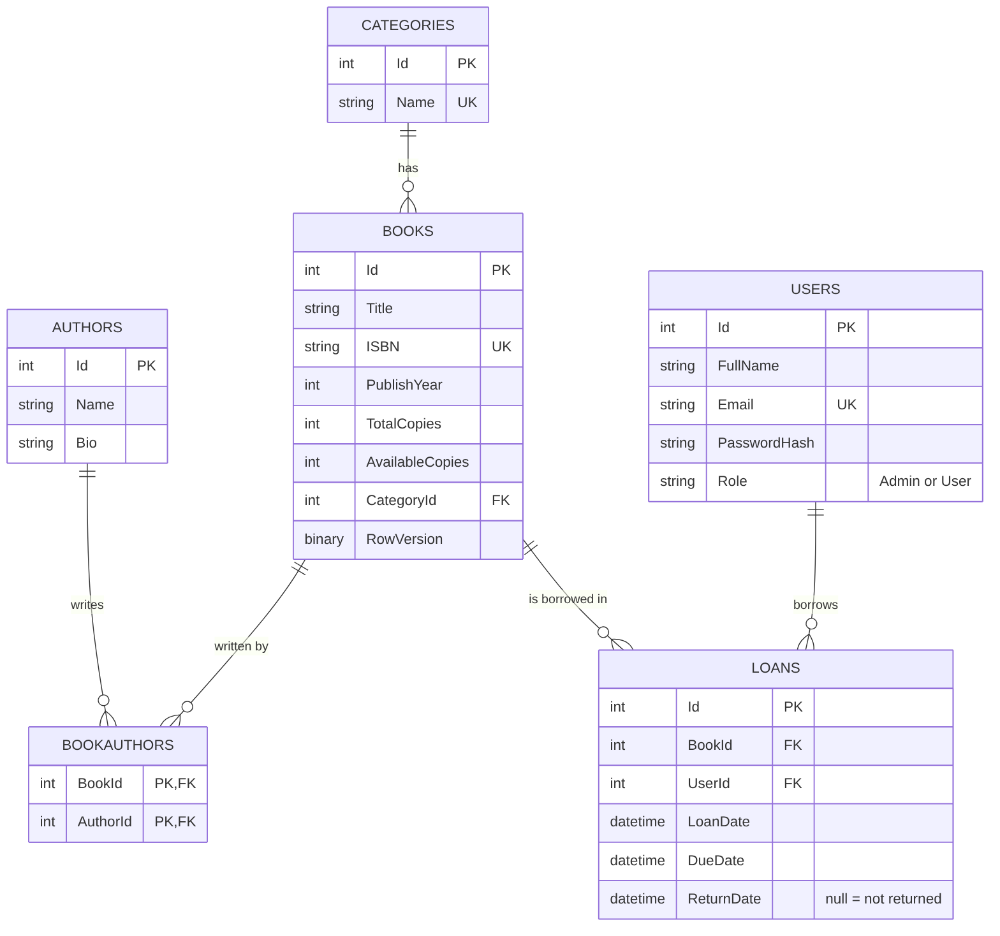

# 📚 Library Management System

A small library system: the **Admin** manages books, authors and categories; a **member (User)** browses the books, borrows them and returns them.

- **Backend:** ASP.NET Core 9 Web API, Clean Architecture (Domain / Application / Infrastructure / API), EF Core 9 Code First + SQL Server, JWT, BCrypt, Swagger
- **Frontend:** plain HTML + CSS + JavaScript (Fetch API, async/await, `localStorage`, DOM `createElement`) — no framework



## Solution structure

| Project | Contains | Depends on |
|---|---|---|
| `Library.Domain` | Entities + Enums only (no packages) | nothing |
| `Library.Application` | DTOs, repository/service interfaces, services (business rules), mappers, exceptions | Domain |
| `Library.Infrastructure` | `DbContext`, Fluent API configurations, repositories, migrations, BCrypt + JWT generation, seeder | Application, Domain |
| `Library.API` | Controllers, `Program.cs`, Swagger, JWT auth, CORS, exception middleware | Application, Infrastructure |

## Run it (step by step)

Requirements: .NET 9 SDK, SQL Server or LocalDB (comes with Visual Studio), `dotnet-ef` tool (`dotnet tool install --global dotnet-ef`).

```bash
# 1. clone and enter the folder
git clone <your-repo-url> && cd LibraryManagement

# 2. (optional) change the connection string in src/Library.API/appsettings.json

# 3. create the FIRST migration (the Migrations folder is created inside Infrastructure)
dotnet ef migrations add InitialCreate -p src/Library.Infrastructure -s src/Library.API

# 4. run the API - it applies the migrations and seeds the data automatically on startup
dotnet run --project src/Library.API
```

Swagger opens at **http://localhost:5080/swagger**. 

Then open the frontend: open `frontend/index.html` with VS Code *Live Server* (or any static server, e.g. `npx serve frontend`).
If the API runs on another port, edit `frontend/js/config.js`.

### Demo accounts (seed data)

| Role | Email | Password |
|---|---|---|
| Admin | `admin@library.com` | `Admin@123` |
| User | `user@library.com` | `User@123` |

(Demo values only. Real deployments must change them in `appsettings.json` → `SeedAdmin` and use a new JWT key.)

### Second migration (add `PhoneNumber` to Users)

The project ships with this field turned off so that you can prove you know how to evolve the database without deleting it.
Search the solution for `MIGRATION-2` (4 places) and uncomment each line:

1. `Library.Domain/Entities/User.cs` → `PhoneNumber` property
2. `Library.Application/DTOs/AuthDtos.cs` → `PhoneNumber` in `RegisterDto`
3. `Library.Application/Services/AuthService.cs` → `user.PhoneNumber = dto.PhoneNumber;`
4. `Library.Application/Mappers/Mappers.cs` → `PhoneNumber = u.PhoneNumber`

```bash
dotnet ef migrations add AddUserPhoneNumber -p src/Library.Infrastructure -s src/Library.API
dotnet run --project src/Library.API      # applies it automatically
```

## Using Swagger with a token
1. `POST /api/auth/login` with the demo account → copy the `token`.
2. Click **Authorize**, paste the token (without the word `Bearer`), confirm.

## Endpoints

| Method | Route | Who | Notes |
|---|---|---|---|
| POST | `/api/auth/register` | Everyone | 201, password stored as BCrypt hash |
| POST | `/api/auth/login` | Everyone | returns JWT (contains user id `sub` and `role`) |
| GET | `/api/books?title=&categoryId=` | Everyone | search by title + filter by category |
| GET | `/api/books/{id}` | Everyone | with authors and category |
| POST / PUT / DELETE | `/api/books` | Admin | 201 / 200 / 204 |
| GET / POST / PUT / DELETE | `/api/authors`, `/api/categories` | GET: everyone, rest: Admin | |
| POST | `/api/loans` | User | body `{ "bookId": 1 }` |
| PUT | `/api/loans/{id}/return` | User | only the owner of the loan |
| GET | `/api/loans/my` | User | current + past loans |
| GET | `/api/loans/overdue` | Admin | not returned and past `DueDate` |

Status codes: `200/201/204` success, `400` validation or business rule (message explains why), `401` no/invalid token or wrong credentials, `403` wrong role or someone else's loan, `404` not found, `409` concurrent update.

### Business rules (in `LoanService` / `BookService`)
- A book can't be borrowed when `AvailableCopies == 0`.
- A member can't have more than **3** active loans.
- Loan period is **14 days** (`DueDate = LoanDate + 14`); overdue = not returned and past `DueDate`.
- Extra: no second active loan of the same book by the same member; can't delete a category/author that still has books or a book that has loans; `TotalCopies` can't go below the copies currently on loan.

## Design decisions (to explain in the review)
- **Why `BookAuthors` is an entity:** Book ↔ Author is many-to-many; the join entity has a composite key `(BookId, AuthorId)`.
- **Delete behaviours:** `Restrict` on Category→Books, Loans→Book/User so history can't vanish by accident; `Cascade` only for the join rows of a deleted book.
- **`Book.RowVersion`:** optimistic concurrency, so two members can't both take the last copy (a `CHECK` constraint also keeps `0 ≤ AvailableCopies ≤ TotalCopies`).
- **Lifetimes:** `DbContext`, repositories and services are **Scoped** (one per request, they share the same DbContext); `BCryptPasswordHasher` and `JwtTokenService` are **Singleton** (stateless).
- **Seeding in code, not `HasData`:** the admin password must be hashed with BCrypt, which creates a different hash every time.
- **No entity leaves the API:** controllers return DTOs only, `PasswordHash` is never in any response.
- **Public registration** always creates role `User`; the Admin comes only from the seed.
- **JWT key** is read from `appsettings.json` (`Jwt:Key`) — use user-secrets / environment variables in production.

## Frontend pages
`index.html` (login/register) · `books.html` (list, search, category filter, borrow; Admin: add/edit/delete form) · `loans.html` (User: *My loans* + return; Admin: overdue loans) · `admin.html` (Admin: authors & categories).
A 401 response sends the user back to the login page; buttons the user isn't allowed to use are not rendered.

## What is not done / known limits
- No automated tests.
- Admin can't create other admins from the UI (change the role in the DB).
- `Migrations` are generated on your machine with the command above (they are not committed in this zip).

## Git workflow used
`main` stays clean; one branch + PR per feature, e.g. `feature/domain-and-db`, `feature/auth`, `feature/books-crud`, `feature/loans`, `feature/frontend`.
Never commit real passwords or private connection strings.
